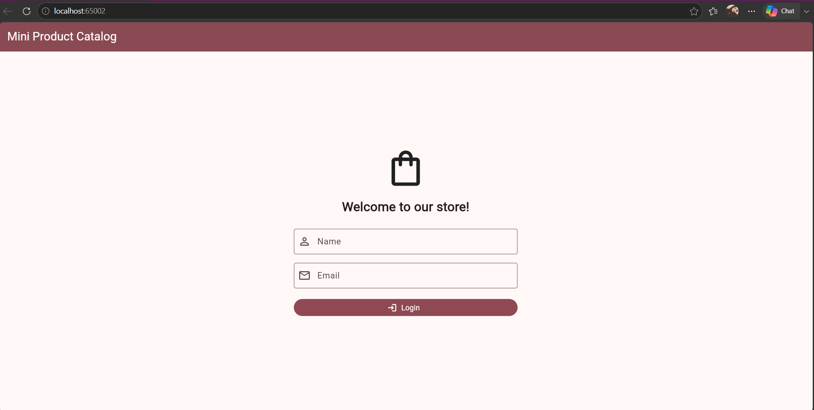
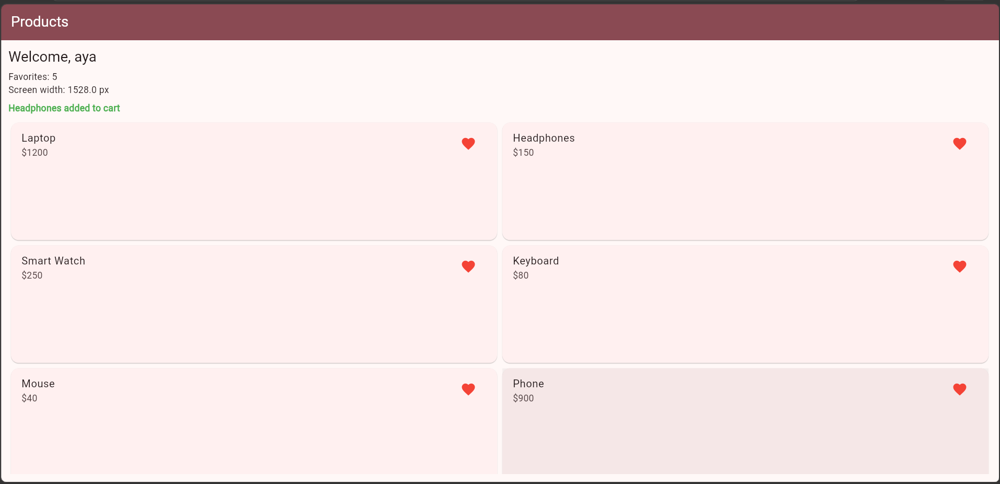
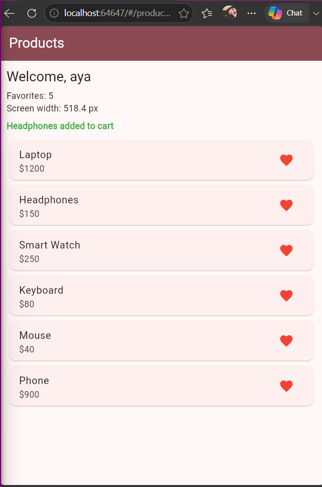
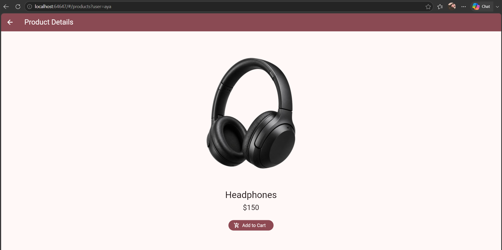
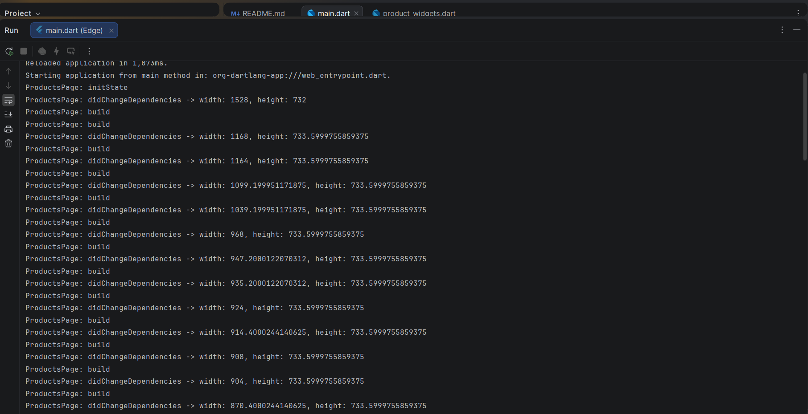

#آية محمد عوض عبدالثادر
# Mini Product Catalog 

A Flutter application that displays a collection of products, allows users to browse product details, and add products to the cart.

##  Project Overview

Mini Product Catalog is a Flutter project built to practice navigation between screens, responsive layouts, form validation, and Flutter widget lifecycle methods.

The project includes two navigation approaches:
- **go_router:** Named routes, path parameters, and query parameters.
- **Navigator:** `pushNamed`, `push`, and `pop`.

##  Features

- Login screen with name and email fields.
- Basic input validation.
- Product catalog with product names, prices, and images.
- Responsive product layout using `ListView` and `GridView`.
- Product details screen.
- Add to Cart button that returns a confirmation message.
- Favorites counter.
- Screen width information.
- Lifecycle logging using `debugPrint`.
- Custom application theme and AppBar colors.

## ️ Technologies Used

- Flutter
- Dart
- Material Design 3
- go_router
- Navigator API

##  Project Structure

```text
lib/
├── main.dart
└── product_widgets.dart

images/
├── lap.png
├── headphone.png
├── smartwatch.png
├── keyboard.png
├── mouse.png
└── phone.png
```

*Note: The structure above is an example based on the project files and image paths used in the code.*

##  Getting Started

### Prerequisites

- Flutter SDK
- Dart SDK
- Android Studio or Visual Studio Code

### Installation

1. Clone or download the project.
2. Open the project folder in your IDE.
3. Install the dependencies:

   ```bash
   flutter pub get
   ```

4. Make sure the product images are configured in `pubspec.yaml`.
5. Run the application:

   ```bash
   flutter run
   ```

## Navigation

### go_router Version

- `/` — Login page
- `/products` — Product catalog page
- `/details/:name/:price` — Product details page

The products route can receive the username through a query parameter, while product details use path parameters.

### Navigator Version

The alternative implementation uses:
- `Navigator.pushNamed()` to open the products page.
- `Navigator.push()` to open product details.
- `Navigator.pop()` to return to the previous page and pass the cart confirmation message.

##  Theme

The application uses Material Design 3 with a burgundy color theme:

- Primary color: `0xFF8A4A53`
- AppBar text and icons: White

##  Learning Objectives

This project demonstrates:
- Flutter navigation and routing.
- Passing data between screens.
- Stateful and stateless widgets.
- Form validation.
- Responsive UI design.
- Asset images.
- Widget lifecycle methods.
- Returning data between routes.

## Screenshots

### 1. Login Screen


### 2. Products  Screen




### 3. Product Details Screen


### 4. Console Screen


